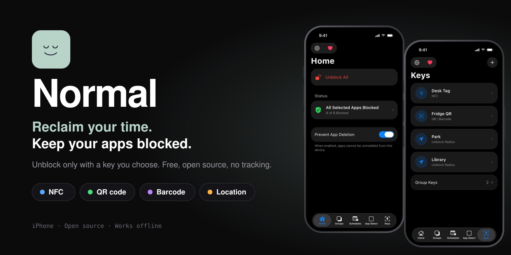

<p align="center">
  
</p>

# Normal — Screen Time Blocker

A powerful screen time blocker that actually works to reduce your screen time. Open source and privacy-focused. No subscriptions, paywalls, or data collection.

<a href="https://ko-fi.com/normalengineering">
  
</a>

## FAQ
[FAQ Available Here](https://www.normalengineering.org/#faq)

## Features

### NFC Tag, QR Code and Barcode Support

Use any NFC tag (AirTags, stickers, cards), QR code, Barcode, or Location to control app blocking.

### App Groups

Create custom categories like Messaging, Social Media, and Email. Block and unblock groups independently for granular screen time control.

### Timed Unlocks

Temporary unlock durations with automatic re-blocking when time expires.

### Adult Content Blocking

Block adult websites across Safari and other apps using Apple's built-in web content filter.

### Hide Blocked Apps

Optionally hide individually blocked apps from the Home Screen, App Library and Search until they're unblocked.

### Automated Schedules

Establish recurring blocking patterns for specific days and times — block email in the evenings, social media on weekdays, and more.

## Privacy

No accounts. No cloud sync. No analytics. No tracking. All settings, keys, and preferences stay on your device.

## Hard to Bypass

Blocked apps stay blocked until you present a key: an NFC tag, QR code, barcode or a saved location. Use Shortcuts to prevent bypassing, and keep the key out of reach, like a tag at the office. The only other way back in is to reset your phone.

## Complete Granular Control

Feature packed so you can do what works best for you.

## Development

Requires the latest stable Xcode and an iOS 17.4+ deployment target. Screen Time blocking (FamilyControls) needs a real device and an Apple developer team with the Family Controls entitlement. The simulator is enough for the unit and UI tests.

```bash
xcodebuild test \
  -project Normal.xcodeproj \
  -scheme Normal \
  -destination "platform=iOS Simulator,name=iPhone 17" \
  -only-testing:NormalTests \
  CODE_SIGNING_ALLOWED=NO
```

## License

See [LICENSE](LICENSE).
